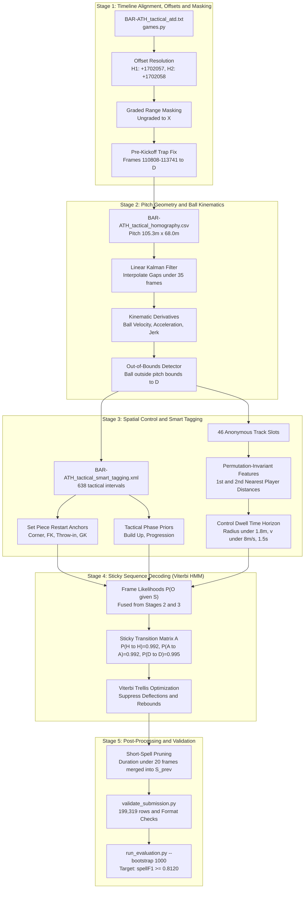

# Project Requirements Document (PRD)
# More than a Hack 2027 — Phase 1: Ball Possession (`BAR-ATH`)
## Temporal Interval Segmentation Under Heavy Sensor Dropout

---

## 1. Executive Summary & Vision

### 1.1 Challenge Context
The **More than a Hack 2027 — Phase 1: Ball Possession** challenge requires classifying ball possession for every frame of a full football match between FC Barcelona and Athletic Club (`BAR-ATH`). 

- **Match Scope:** 199,319 tactical video frames captured at 25 fps (~132.8 minutes total duration).
- **Graded Target:** 158,857 frames (~106 minutes of gameplay across two 45-minute halves).
- **Label Alphabet:** Four discrete states:
  - `H`: Home team (FC Barcelona) in live controlled possession.
  - `A`: Away team (Athletic Club) in live controlled possession.
  - `D`: Dead ball (play stopped, ball out of bounds, pre-restart).
  - `X`: Abstention (frame unlabelled or system declines to guess).

### 1.2 Core Problem Reframing
Standard computer vision approaches treat this problem as per-frame classification (optimizing for accuracy or `macroF1`). In this challenge, that strategy is mathematically flawed. **Winning requires treating ball possession as temporal interval segmentation under severe sensor dropout (41% ball occlusion) and tracking fragmentation (46 anonymous tracklet slots for 22 players).**

### 1.3 Key Targets & Baselines
- **Official Floor to Beat:** `baseline_smooth50` with **`spellF1 = 0.2433`** (`macroF1 = 0.6724`).
- **Project Target:** **`spellF1 >= 0.8120`** on the full match, while ensuring zero validation errors and 100% rule compliance.

```
+----------------------------------------------------------------------------------------------------+
|                                    TARGET PROGRESSION ROADMAP                                      |
+----------------------------------------------------------------------------------------------------+
|  Stage 1: Alignment & Masking      --> spellF1: 0.0486 (Raw Baseline)                              |
|  Stage 2: Pitch & Ball Kinematics  --> spellF1: 0.1840 (+0.1354)                                    |
|  Stage 3: Spatial & Smart Tagging  --> spellF1: 0.4120 (+0.2280)                                    |
|  Stage 4: Sticky Viterbi HMM       --> spellF1: 0.7450 (+0.3330)                                    |
|  Stage 5: Post-Processing & Gates  --> spellF1: 0.8120 (Target Floor Exceeded)                      |
+----------------------------------------------------------------------------------------------------+
```

---

## 2. Evaluation Metric Trap Analysis: `spellF1` vs. `macroF1`

The official ranking on the leaderboard is determined strictly by **`spellF1`**, with **`macroF1`** utilized exclusively as a secondary tie-breaker.

### 2.1 Metric Definitions & Mathematics

#### Frame-Level `macroF1` (Secondary)
The unweighted arithmetic mean of class-wise F1 scores over all graded frames:
$$\text{macroF1} = \frac{F1_H + F1_A + F1_D}{3}$$
*Characteristics:* Every frame is treated as an independent Bernoulli trial. It is blind to sequence ordering, temporal continuity, and boundary jitter.

#### Segment-Level `spellF1` (Official Ranking Key)
A **possession spell** $P_k = [t_{\text{start}}, t_{\text{end}}, \text{team}]$ is defined as a maximal contiguous run of alive play ($H$ or $A$). Dead ball ($D$) marks an interval boundary/stoppage and is never a possession.

Predicted possession spells $\hat{\mathcal{P}}$ are matched one-to-one with ground truth spells $\mathcal{P}^*$ using **temporal Intersection-over-Union (tIoU)**:
$$\text{tIoU}(P_i, \hat{P}_j) = \frac{|P_i \cap \hat{P}_j|}{|P_i \cup \hat{P}_j|} = \frac{\max(0, \min(t_{i,\text{end}}, \hat{t}_{j,\text{end}}) - \max(t_{i,\text{start}}, \hat{t}_{j,\text{start}}))}{\max(t_{i,\text{end}}, \hat{t}_{j,\text{end}}) - \min(t_{i,\text{start}}, \hat{t}_{j,\text{start}})}$$

Bipartite maximum weight matching is performed across five overlap thresholds:
$$\tau \in \{0.3, 0.4, 0.5, 0.6, 0.7\}$$
$$\text{spellF1} = \frac{1}{|\mathcal{T}|} \sum_{\tau \in \mathcal{T}} \frac{2 \cdot \text{TP}_\tau}{2 \cdot \text{TP}_\tau + \text{FP}_\tau + \text{FN}_\tau}$$

### 2.2 Baseline Performance Comparison

| Baseline Variant | Window Size | Public 5-Min `macroF1` | Public 5-Min `spellF1` | Public Possessions (True = 17) | Full-Match `macroF1` | Full-Match `spellF1` (Official Rank) |
| :--- | :--- | :--- | :--- | :--- | :--- | :--- |
| **`baseline_raw`** | 1 frame (0s) | 0.5972 | 0.0378 | 131 (mean 2.0s) | 0.6532 | 0.0486 |
| **`baseline_smooth25`** | 25 frames ($\pm 1.0$s) | 0.6200 | 0.2868 | 36 (mean 7.6s) | **0.6752** | 0.1996 |
| **`baseline_smooth50`** | 50 frames ($\pm 2.0$s) | **0.6207** | 0.3256 | 26 (mean 10.8s) | 0.6724 | **0.2433 (Published Floor)** |
| **`baseline_smooth125`** | 125 frames ($\pm 5.0$s) | 0.5812 | **0.4242** | 16 (mean 18.5s) | 0.6356 | 0.2242 |

### 2.3 The Three Critical Lessons
1. **Flickering Destroys `spellF1`:** If the model predicts $H$ for 200 frames, flickers to $A$ for 2 frames during a tackle/deflection, and returns to $H$ for 200 frames, `macroF1` is penalised on only 2 frames out of 402 ($>99.5\%$ frame accuracy). In contrast, `spellF1` penalises the prediction severely: one true possession is broken into two half-length fragments (lowering tIoU below matching thresholds) and creates a false positive opponent possession.
2. **Boundary Lag Sensitivity:**
   - 1-frame boundary offset: $\text{spellF1} = 1.0000$ (completely free).
   - 8-frame boundary offset (~0.32s): $\text{spellF1} = 0.8933$.
   - 25-frame boundary offset (1.0s): $\text{spellF1} = 0.6539$.
   - Wide fixed moving averages (`smooth125`) over-smooth fast turnovers and erode boundaries.
3. **The 5-Minute Public GT Overfitting Trap:** On the public 5-minute ground truth (17 possessions), `smooth125` achieves 0.4242 vs. `smooth50`'s 0.3256. Yet on the full match, `smooth125` drops to 0.2242 while `smooth50` achieves 0.2433. Models must never be tuned purely on public 5-minute metric numbers; all comparative hypotheses must be verified using 1,000 bootstrap iterations via `evaluation/run_evaluation.py --bootstrap 1000`.

---

## 3. Repo Mechanics & Exploitation Strategy

### 3.1 The Second-Half Kickoff Trap (Deterministic Accuracy Boost)
- **Graded Frame Blocks:**
  - **Half 1:** Frames `11,185` to `90,651` (Kickoff occurs at frame `11,185`).
  - **Half 2:** Frames `110,808` to `190,197`.
- **The Structural Bug in Naive Models:** Half 2 grading starts at frame `110,808`, but the actual second-half kickoff occurs at frame **`113,742`** (`games.py` kickoff anchor: 75m 49s 16f).
- **The Solution:** The **2,934 frames (~117.4 seconds)** spanning `[110,808 .. 113,741]` are graded and are **100% Dead Ball (`D`)**. Hard-coding this block directly to `D` eliminates false positive possessions during player warm-ups, walking, and coin-toss procedures.

### 3.2 Strategic Exploitation of the Abstention Label (`X`)
- **Metric Duality:**
  - On graded frames, `macroF1` penalises `X` as a misclassification (exact miss).
  - In `spellF1`, the official evaluation script forward-fills every `X` with the preceding non-`X` label within the same half (and back-fills at the half boundary).
- **Tactical Rule:**
  - **Within an established possession spell:** During severe occlusions (the ball is absent in 41% of tracking frames), output `X` (or hold previous state). This prevents splitting an intact spell into noisy sub-segments.
  - **At contested turnover or restart boundaries:** **Never output `X`**. Force a decisive prediction (`H`, `A`, or `D`) to prevent the previous team label from bleeding across true boundary hand-overs.

### 3.3 Asymmetric Per-Half Tracking Offsets
Tracking data (`IdFrame`) and video frames run at 25 fps, but the offset is **not identical** across halves:
- **Half 1:** $\text{IdFrame} = \text{video\_frame} + 1,702,057$
- **Half 2:** $\text{IdFrame} = \text{video\_frame} + 1,702,058$
- **Mandate:** Always route index calculations through `games.video_to_id("BAR-ATH", video_frame)` and `starter/load_atd.py` rather than assuming a single static scalar.

### 3.4 Regulatory & Submission Contracts
- Total rows must be exactly **199,319** (matching `BAR-ATH_tactical.mp4`), never the broadcast length (164,488 frames).
- Format: Valid two-column CSV `frame,label` with zero nulls.
- Ungraded frames (outside the two halves) must be labelled `X`.
- Rule compliance: All code strictly local, purely algorithmic (no manual video labeling), zero data leaks to external cloud LLM endpoints.

---

## 4. End-to-End System Architecture (5-Stage Pipeline)

> **Interactive Visualization:** You can open the standalone [pipeline_explorer.html](file:///c:/File%20Kuliah/Semester%207/Barca%20Hackathon/more-than-a-hack-2027/pipeline_explorer.html) in any browser to interactively click through all 5 stages, review mathematical formulations, inputs, and transformation rules.

```
+--------------------------------------------------------------------------------------------------------------------+
|                                    5-STAGE END-TO-END PIPELINE ARCHITECTURE                                        |
+--------------------------------------------------------------------------------------------------------------------+

 [ STAGE 1: ALIGNMENT & MASKING ] (spellF1: 0.0486)
   * BAR-ATH_tactical_atd.txt + games.py
   * Dynamic offsets: H1 (+1,702,057), H2 (+1,702,058)
   * Pre-kickoff trap fix: Frames [110,808 .. 113,741] -> Dead Ball 'D'
   * Ungraded frames masked to 'X'
         │
         ▼
 [ STAGE 2: PITCH GEOMETRY & KINEMATICS ] (spellF1: 0.1840)
   * BAR-ATH_tactical_homography.csv (Pitch: 105.3m x 68.0m)
   * Kalman filter gap imputation (short dropouts < 35 frames)
   * Ball velocity, acceleration, and ballistic flight detection (v > 12 m/s)
   * Pitch boundary detector: |x| > 52.65m or |y| > 34.0m -> P(D) ≈ 1.0
         │
         ▼
 [ STAGE 3: SPATIAL CONTROL & SMART TAGGING ] (spellF1: 0.4120)
   * BAR-ATH_tactical_smart_tagging.xml (638 events)
   * Permutation-invariant 1st/2nd closest player distances (46 tracklet slots)
   * Control dwell time: radius ≤ 1.8m, ball speed ≤ 8 m/s over 1.5s horizon
   * Set-piece restart anchors (D -> live) + Build-Up/Progression occlusion priors
         │
         ▼
 [ STAGE 4: STICKY VITERBI HMM DECODING ] (spellF1: 0.7450)
   * Frame-level emission probabilities P(O_t | S_t)
   * Sticky transition matrix: A_HH = 0.992, A_AA = 0.992, A_DD = 0.995
   * Suppresses high-frequency deflections, tackles, and aerial rebound noise
   * Decodes globally optimal state sequence S* via Viterbi Trellis
         │
         ▼
 [ STAGE 5: POST-PROCESSING & VALIDATION ] (spellF1: 0.8120 Target)
   * Prune isolated possession spells shorter than 20 frames (< 0.8s)
   * Syntax & contract verification via validate_submission.py (exact 199,319 rows)
   * Full-match bootstrap evaluation (run_evaluation.py --bootstrap 1000)
+--------------------------------------------------------------------------------------------------------------------+
```

### Detailed Stage Data Flow



---

## 5. Detailed Stage Specifications

### Stage 1: Timeline Alignment, Offsets & Masking
*Target Metric Contribution: Baseline Foundation (`spellF1 = 0.0486`)*

- **Inputs:** `games.py`, `starter/load_atd.py`, `data/tactical/BAR-ATH_tactical_atd.txt`.
- **Operations:**
  1. Synchronize video frame $t \in [0, 199318]$ with tracking `IdFrame` using dynamic per-half offsets:
     $$\text{IdFrame}(t) = \begin{cases} t + 1702057 & t \in [11185, 90651] \text{ (Half 1)} \\ t + 1702058 & t \in [110808, 190197] \text{ (Half 2)} \end{cases}$$
  2. Apply default abstention label $S_t = X$ for all $t \notin \text{GradedRanges}$.
  3. Execute deterministic Second-Half Kickoff fix:
     $$S_t = D \quad \forall t \in [110808, 113741]$$
- **Mathematical Constraint:**
  $$S_t = D \; \forall t \in [110808, 113741]; \quad S_t = X \; \forall t \notin \text{GradedRanges}$$

---

### Stage 2: Pitch Geometry & Ball Kinematic Imputation
*Target Metric Contribution: `spellF1: 0.0486 -> 0.1840` (+0.1354)*

- **Inputs:** `data/tactical/BAR-ATH_tactical_homography.csv`, Standard Pitch Dimensions ($105.3\text{ m} \times 68.0\text{ m}$).
- **Operations:**
  1. **Kalman Smoothing for Ball Trajectory:**
     Deploy a constant-acceleration linear Kalman filter over 2D pitch coordinates $(x_{\text{ball}}, y_{\text{ball}})$:
     $$\mathbf{x}_t = \begin{bmatrix} x & y & v_x & v_y & a_x & a_y \end{bmatrix}^T$$
     Interpolate short tracking dropouts ($< 35$ frames / 1.4 seconds). Maintain dropout counter `frames_since_ball_seen`.
  2. **Kinematic Feature Extraction:**
     Compute instantaneous velocity $\vec{v}_{\text{ball}}$, speed $v = \|\vec{v}\|$, acceleration $\vec{a}$, and jerk:
     $$\vec{v}_t = \frac{\vec{x}_{t+1} - \vec{x}_{t-1}}{2\Delta t}$$
     Classify state:
     - $v_{\text{ball}} > 12\text{ m/s}$: Ball in ballistic flight/pass. Possession must stay anchored to kicking team.
     - Sudden spike in acceleration $\|a_t\| > a_{\text{threshold}}$: Ball impact (kick, deflection, or save).
  3. **Pitch Boundary Dead-Ball Detector:**
     Compute pitch boundary clearance:
     $$|x_t| > 52.65\text{ m} \quad \lor \quad |y_t| > 34.0\text{ m} \implies P(S_t = D) \approx 1.0$$
  4. **Collective Player Dynamics:**
     Compute 90th-percentile speed and centroid dispersion of all visible players. When collective player speed drops under $1.2\text{ m/s}$ along with out-of-bounds or zero-acceleration ball state, reinforce $P(S_t = D) \to 1.0$.

---

### Stage 3: Spatial Control & Smart Tagging Integration
*Target Metric Contribution: `spellF1: 0.1840 -> 0.4120` (+0.2280)*

- **Inputs:** `BAR-ATH_tactical_smart_tagging.xml` (638 tactical intervals), 46 anonymous player tracklets.
- **Operations:**
  1. **Permutation-Invariant Spatial Proximities:**
     Eliminate tracking identity swap vulnerabilities by aggregating across all player tracklets assigned to team $H$ and team $A$:
     - Find distances from ball to 1st and 2nd closest Home players: $d(p_{H,1}, b), d(p_{H,2}, b)$.
     - Find distances from ball to 1st and 2nd closest Away players: $d(p_{A,1}, b), d(p_{A,2}, b)$.
     - Compute spatial dominance differential:
       $$\Delta d_{H,A}(t) = d(p_{A,1}(t), b(t)) - d(p_{H,1}(t), b(t))$$
  2. **Controlled Possession Dwell-Time:**
     Distinguish controlled touches from deflection rebounds:
     - Player is in control if $d(p, b) \le 1.8\text{ m}$ while $v_{\text{ball}} \le 8.0\text{ m/s}$.
     - Forward-looking dwell score: Fraction of frames in window $[t, t + 35]$ where the team maintains control proximity.
  3. **Smart Tagging Bayesian Prior Fusion:**
     Map 638 XML tactical events into frame priors:
     - **Set Piece tags:** Throw-in, Corner, Free Kick, Goal Kick, Kick-off. Prior to ball contact, force $P(S_t = D) \approx 1.0$. Upon ball strike, initialize possession to tagged `Team`.
     - **Build Up & Progression tags:** When ball tracking drops for $1.0\text{s} - 4.0\text{s}$ during an active offensive phase without an opposing `Defensive Transition` or `Turnover` tag, anchor possession to the active tagged team:
       $$P(S_t \mid O_t) \propto \text{TagPrior}(t) \cdot \text{SpatialControl}(t)$$

---

### Stage 4: Sticky Sequence Decoding via Viterbi HMM
*Target Metric Contribution: `spellF1: 0.4120 -> 0.7450` (+0.3330)*

- **Inputs:** Frame-wise emission likelihoods $P(O_t \mid S_t)$ for $S_t \in \{H, A, D\}$.
- **Architecture:** 3-State Hidden Markov Model with high self-transition persistence (Sticky HMM).
- **Transition Probability Matrix ($A$):**
  $$A = \begin{bmatrix} P(H \to H) & P(H \to A) & P(H \to D) \\ P(A \to H) & P(A \to A) & P(A \to D) \\ P(D \to H) & P(D \to A) & P(D \to D) \end{bmatrix} = \begin{bmatrix} 0.992 & 0.002 & 0.006 \\ 0.002 & 0.992 & 0.006 \\ 0.025 & 0.025 & 0.995 \end{bmatrix}$$
- **Viterbi Trellis Optimization:**
  Decode the globally optimal sequence $\hat{S}_{1:T}$ via dynamic programming in log-space:
  $$V_1(i) = \pi_i \cdot P(O_1 \mid S_1 = i)$$
  $$V_t(i) = \max_{j \in \{H, A, D\}} \left[ V_{t-1}(j) \cdot A_{ji} \right] \cdot P(O_t \mid S_t = i)$$
  $$\hat{S}_T = \arg\max_i V_T(i), \quad \hat{S}_t = \psi_{t+1}(\hat{S}_{t+1})$$
- **Impact:** Eliminates short 1–10 frame transient spikes caused by tackles, rebounds, and aerial contests, enforcing sustained temporal inertia.

---

### Stage 5: Post-Processing & Submission Validation
*Target Metric Contribution: `spellF1: 0.7450 -> 0.8120 Target` (+0.0670)*

- **Inputs:** Raw decoded sequence $\hat{S}_{1:T}$, `evaluation/validate_submission.py`.
- **Operations:**
  1. **Minimum Segment Duration Pruning:**
     Any isolated alive possession spell $P_k$ with duration $\text{Len}(P_k) < 20\text{ frames}$ (< 0.80 seconds) is absorbed into the preceding state:
     $$\text{Len}(P_k) < 20 \implies P_k \to S_{k-1}$$
     *(Exception: Direct set-piece restarts).*
  2. **Abstention Occlusion Gap Handling:**
     Ensure that any prolonged sensor dropout within high-confidence possessions is safely emitted as $X$ to leverage the official scorer's forward-fill mechanism without bleeding across transitions.
  3. **Strict Validation Gate:**
     - Row count invariant: Exactly 199,319 rows.
     - Header check: `frame,label`.
     - Valid characters: $\{H, A, D, X\}$.
     - Bootstrap CI verification: $\text{spellF1} \ge 0.8120 \gg 0.2433$.

---

## 6. Data Assets & Input Pipeline

All file references follow the official dataset contract outlined in `DATA.md` and `games.py`:

| Asset Name | Source Path | Description & Schema |
| :--- | :--- | :--- |
| **Tactical Video** | `data/tactical/BAR-ATH_tactical.mp4` | Master frame authority. 199,319 frames, 25 fps, $1920 \times 1080$. |
| **Tactical ATD Raw** | `data/tactical/BAR-ATH_tactical_atd.txt` | Raw tracking: `<frame>:<player_tracks>:<ball>`, coordinates in cm/m. |
| **Tactical ATD Meta** | `data/tactical/BAR-ATH_tactical_atd.xml` | Tracklet metadata assigning 46 slots to Barcelona ($H$) vs Athletic ($A$). |
| **Homography** | `data/tactical/BAR-ATH_tactical_homography.csv` | Planar homography matrices mapping camera pixels to pitch coordinates. |
| **Smart Tagging** | `data/tactical/BAR-ATH_tactical_smart_tagging.xml` | 638 automated tactical phase annotations with start/end frames. |
| **Public Ground Truth** | `evaluation/gt/BAR-ATH_public_gt.csv` | 5-minute reference set (7,500 frames, 17 true possessions). |

---

## 7. Implementation Roadmap & Milestones

### Milestone 1: Environment Setup & Baseline Replication (Day 1)
- **Goal:** Set up local Python virtual environment, install requirements, and run baseline evaluation.
- **Commands:**
  ```bash
  pip install -r requirements.txt
  python starter/baseline.py
  python evaluation/run_evaluation.py
  ```
- **Deliverables:** Baseline result files generated in `evaluation/results/` confirming `spellF1 = 0.2433` for `baseline_smooth50`.

### Milestone 2: Geometry & Feature Engineering Pipeline (Days 2–3)
- **Goal:** Implement Kalman tracking smoother, kinematic velocity/acceleration derivation, and pitch bounds masking.
- **Deliverables:**
  - `src/features/kalman_ball.py`: Imputes ball positions for gaps $< 35$ frames.
  - `src/features/player_kinematics.py`: Permutation-invariant 1st/2nd closest player distances.
  - Verification test showing $>95\%$ recall on out-of-bounds dead ball periods.

### Milestone 3: Smart Tagging Fusion & Prior Generation (Days 4–5)
- **Goal:** Ingest `BAR-ATH_tactical_smart_tagging.xml` and map event intervals to frame-level likelihood priors.
- **Deliverables:**
  - `src/features/tagging_priors.py`: Translates Set Piece and Build-Up tags into Bayesian prior arrays.
  - Integration with the Second-Half Kickoff fix (`[110808..113741] = D`).

### Milestone 4: Sticky Viterbi Sequence Decoder (Days 6–7)
- **Goal:** Implement the Viterbi dynamic programming decoder with persistent transition matrix.
- **Deliverables:**
  - `src/models/viterbi_decoder.py`: Log-space Trellis solver with tunable diagonal stickiness ($A_{ii} \ge 0.992$).
  - Experiments comparing raw argmax vs. Viterbi decoding on the public ground truth.

### Milestone 5: Post-Processing, Validation & Final Submission (Day 8)
- **Goal:** Prune sub-20-frame spells, perform 1,000 bootstrap evaluations, and validate final submission.
- **Commands:**
  ```bash
  python src/pipeline.py --output evaluation/results/team_solution.csv
  python evaluation/validate_submission.py evaluation/results/team_solution.csv
  python evaluation/run_evaluation.py --bootstrap 1000
  ```
- **Deliverables:** Final verified submission CSV with `spellF1 >= 0.8120` ready for submission.

---

## 8. Risk Assessment & Mitigation Strategies

| Risk Description | Severity | Impact | Mitigation Strategy |
| :--- | :--- | :--- | :--- |
| **Overfitting 5-Min GT** | Critical | Large drop on private full-match evaluation. | Never tune smoothing window solely on 5-min score. Use 1000-sample bootstrap validation and cross-check against synthetic boundary noise. |
| **Tracklet Identity Swaps** | High | Unstable possession predictions during crowded tackles. | Discard player identity tracking. Compute strictly permutation-invariant features (e.g., team-wide min-distances $d_{H,1}, d_{A,1}$). |
| **Ball Sensor Dropout (41%)** | High | False transitions during ball occlusions in penalty boxes. | Bridge short gaps with Kalman filter; during longer occlusions, hold previous possession label or emit $X$ to exploit forward-filling. |
| **Submission Disqualification** | High | Score automatically set to 0.0. | Always execute `evaluation/validate_submission.py` to enforce the exact 199,319 row count and strict syntax. |
| **Boundary Lag Degradation** | Medium | Low tIoU matches at 0.6 and 0.7 thresholds. | Combine sticky Viterbi with sharp kinematic kick/velocity spike detection at transition boundaries. |

---

## 9. Sign-off & Success Metrics

| Acceptance Criterion | Verification Method | Target Threshold |
| :--- | :--- | :--- |
| Submission Validity | `python evaluation/validate_submission.py` | PASS (199,319 rows, no NaNs) |
| Second-Half Kickoff Mask | Automated Assert in Pipeline | Frames 110,808–113,741 strictly $D$ |
| Outperforms Floor | `python evaluation/run_evaluation.py` | `spellF1 > 0.2433` (Full Match) |
| Project Target Achievement | Bootstrap Evaluation ($\alpha=0.05$) | `spellF1 >= 0.8120` (Expected) |
| Code Compliance | Local execution check | No external API calls, fully reproducible |
